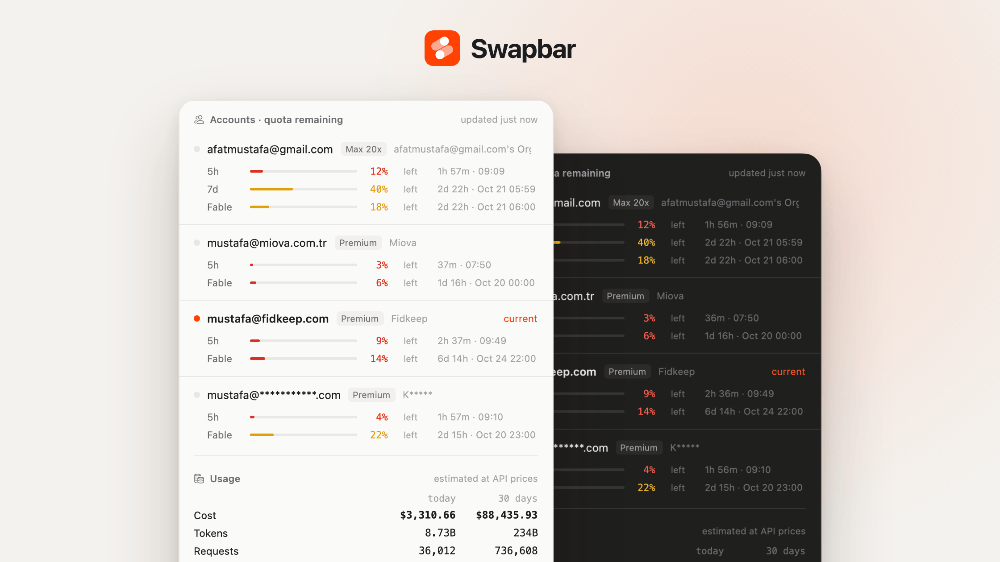
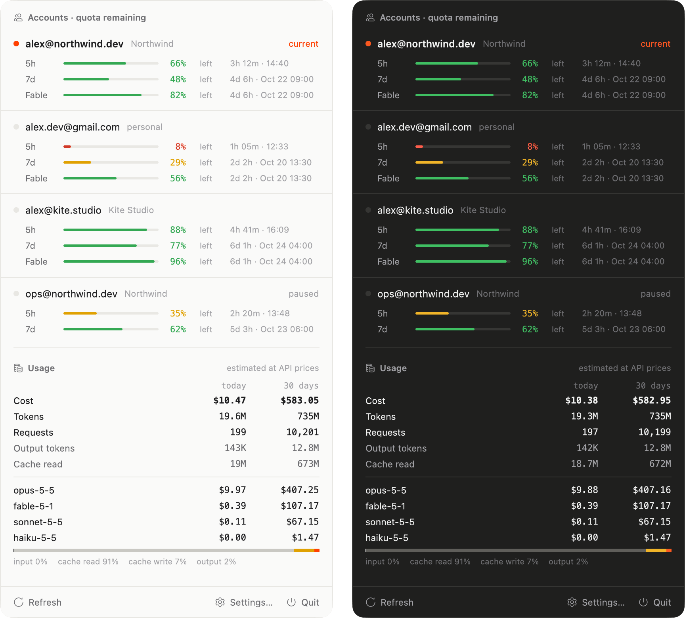
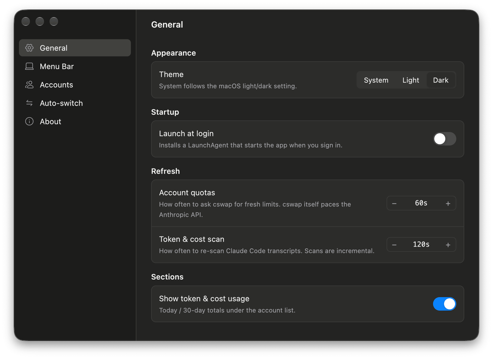
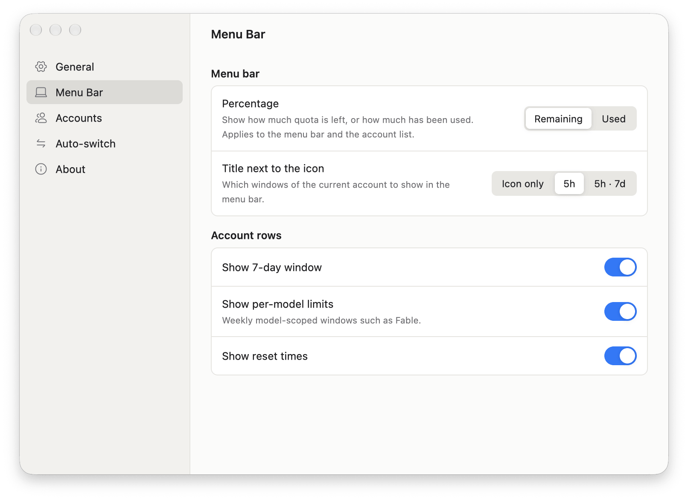
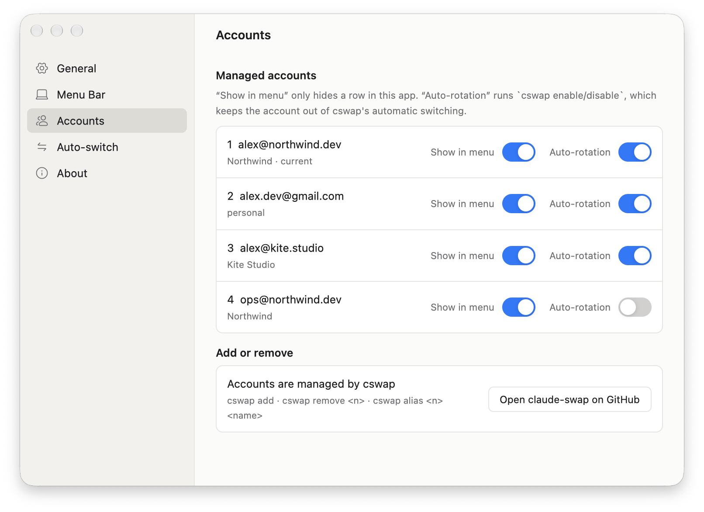
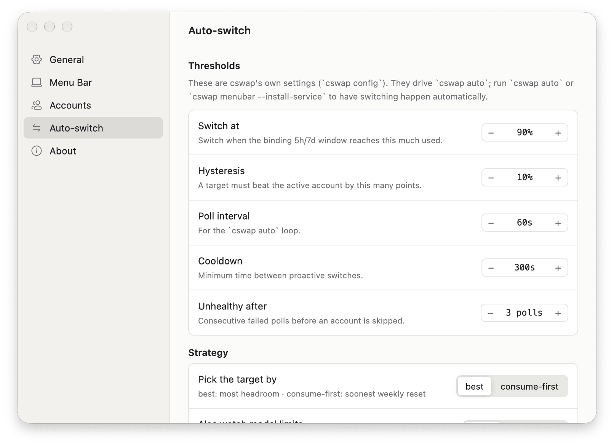

<p align="center">
  
</p>

<p align="center">
  Every Claude account's quota in view, one click to switch.<br>
  A macOS menu bar app for <a href="https://github.com/realiti4/claude-swap"><code>claude-swap</code></a> (cswap).
</p>

<p align="center">
  <a href="https://github.com/afatmustafa/swapbar/releases/latest"><b>Download</b></a> ·
  <a href="https://afat.me">Website</a> ·
  <b>English</b> | <a href="README.tr.md">Türkçe</a>
</p>

<p align="center">
  
</p>

Swapbar shows the 5h, 7d and per-model (Fable) quotas of every cswap account at a glance, switches accounts with one click, and summarizes token usage and cost from Claude Code transcripts.

## Features

- **All accounts, one glance.** Each account shows its plan (Max 20x, Max 5x, Pro, Team Premium/Standard) and gets 5h, 7d and per-model (Fable) bars with time to reset. The bars turn yellow at 40% left and red at 15%.
- **One-click switching.** Click an inactive account to run `cswap switch`. The active account is marked **current**, and accounts left out of auto-rotation show as **paused**.
- **Quota in the menu bar.** The Swapbar icon is followed by the active account's quota, as `5h` or `5h · 7d`, shown as remaining or used.
- **Token and cost summary.** Today and 30-day totals for cost, tokens, requests, output and cache reads, a per-model cost breakdown, and a bar splitting input, cache read, cache write and output.
- **Light and dark.** Follows the macOS appearance, or set it to Light or Dark in Settings.
- **Small and native.** Rust and [gpui](https://crates.io/crates/gpui) (Zed's UI framework), a universal binary for Apple Silicon and Intel, about 4 MB.

## Settings

Open **Settings…** from the popover. Preferences are stored in `~/.config/swapbar/settings.json`.

<table>
  <tr>
    <td width="50%"></td>
    <td width="50%"></td>
  </tr>
  <tr>
    <td><b>General:</b> theme (System / Light / Dark), launch at login (LaunchAgent), refresh intervals, show or hide the usage section.</td>
    <td><b>Menu Bar:</b> percentage mode (remaining / used), title next to the icon (icon only / 5h / 5h · 7d), 7-day window, per-model limits, reset times.</td>
  </tr>
  <tr>
    <td></td>
    <td></td>
  </tr>
  <tr>
    <td><b>Accounts:</b> show or hide each account in the menu, include it in auto-rotation (<code>cswap enable/disable</code>).</td>
    <td><b>Auto-switch:</b> cswap's <code>autoswitch.*</code> settings (<code>cswap config set</code>), reset to defaults. These only take effect while <code>cswap auto</code> is running.</td>
  </tr>
</table>

## Installation

### Download

1. Install [`claude-swap`](https://github.com/realiti4/claude-swap) and add your accounts with `cswap add`.
2. Download `Swapbar.dmg` from the [latest release](https://github.com/afatmustafa/swapbar/releases/latest) and drag Swapbar to Applications.
3. Open Swapbar. Its icon appears in the menu bar; click it to open the popover.

Swapbar looks for `cswap` at `~/.local/bin/cswap`, `/opt/homebrew/bin/cswap` and `/usr/local/bin/cswap`. Set `CSWAP_BIN` to use another path.

Releases from 0.1.1 on are signed with a Developer ID and notarized by Apple, so Swapbar opens with a double-click. Version 0.1.0 is not: macOS blocks its first launch, and you allow it with **Open Anyway** under System Settings → Privacy & Security.

To launch at login, turn on **Launch at login** in Settings.

### Build from source

```sh
./scripts/bundle.sh                    # release build, produces target/Swapbar.app
./scripts/bundle.sh --universal        # arm64 + x86_64
./scripts/dmg.sh                       # target/Swapbar.dmg from the bundle
cp -R target/Swapbar.app /Applications/
```

Requirements:

- Rust toolchain
- Xcode. gpui is built with the `runtime_shaders` feature, so the Metal toolchain is not needed.

## How it works

| Data | Source |
|---|---|
| Accounts, 5h/7d/Fable quotas | `cswap list --json`, every 60 seconds. cswap calls the Anthropic usage API itself. That endpoint allows roughly 30 requests per hour per account, so cswap manages the polling cadence. |
| Account switching | `cswap switch <n> --json` |
| Tokens and cost | `~/.claude/projects/**/*.jsonl`, plus `CLAUDE_CONFIG_DIR`, `~/.claude-*` profiles and cswap session directories. Entries are deduplicated by `message.id:requestId` and rescanned incrementally every 2 minutes. |
| Prices | Built-in table with a [models.dev](https://models.dev/api.json) overlay (cached for 24 hours). 1h cache write = 2× input, 5m cache write = 1.25× input. |

Caches live in `~/.config/swapbar/` (`usage-cache.json`, `model-rates.json`).

Cost figures are estimates at API list prices, not your subscription bill.

Swapbar does not talk to Anthropic directly. Quotas come from cswap, and usage is read from transcripts on your Mac.

## Development

```sh
cargo run                                          # click the Swapbar icon in the menu bar
SWAPBAR_OPEN=1 cargo run                           # open the popover on launch
SWAPBAR_SETTINGS=1 SWAPBAR_PAGE=about cargo run    # open settings on a given page
SWAPBAR_DEBUG=1 cargo run                          # geometry and scan logs
cargo run -- --scan                                # headless: print the token and cost summary
./scripts/icon.sh                                  # rebuild assets/AppIcon.icns from AppIcon.svg
```

`SWAPBAR_PAGE` accepts `menubar`, `accounts`, `auto` and `about`; anything else opens General.

The popover and settings screenshots use demo accounts and generated transcripts. Usage and quota figures in the header image are illustrative.

### Files

- `src/main.rs`: app state, timers, window open/close, menu bar title
- `src/statusbar.rs`: NSStatusItem (cocoa), click callback, screen geometry
- `src/cswap.rs`: bridge to `cswap list/switch --json`
- `src/usage.rs`: JSONL scanner, cache, period summaries
- `src/pricing.rs`: model prices
- `src/assets.rs`: embedded SVG icons (AssetSource)
- `src/theme.rs`: light/dark appearance
- `src/ui.rs`: popover UI
- `src/settings.rs`: preferences model, LaunchAgent
- `src/settings_ui.rs`: settings window and About page

### Website

The landing page lives in its own repository, `swapbar-website`.

## Credits

Icons are [Hugeicons](https://hugeicons.com/?via=afat) stroke-rounded (MIT, in `assets/icons/`). Account data and switching come from [claude-swap](https://github.com/realiti4/claude-swap).

Made by [Mustafa Afat](https://afat.me).
